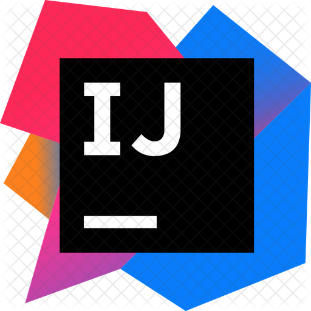
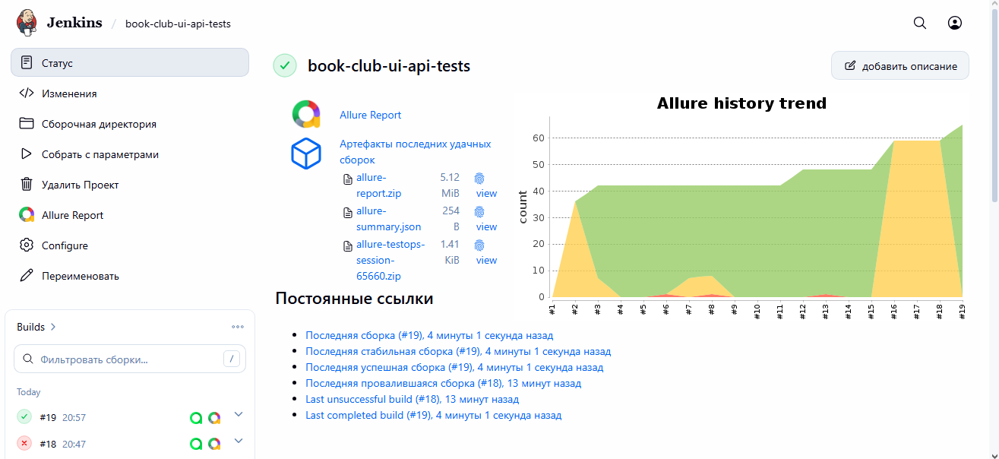
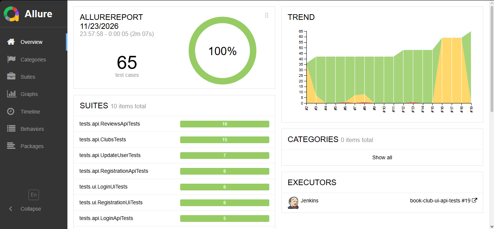
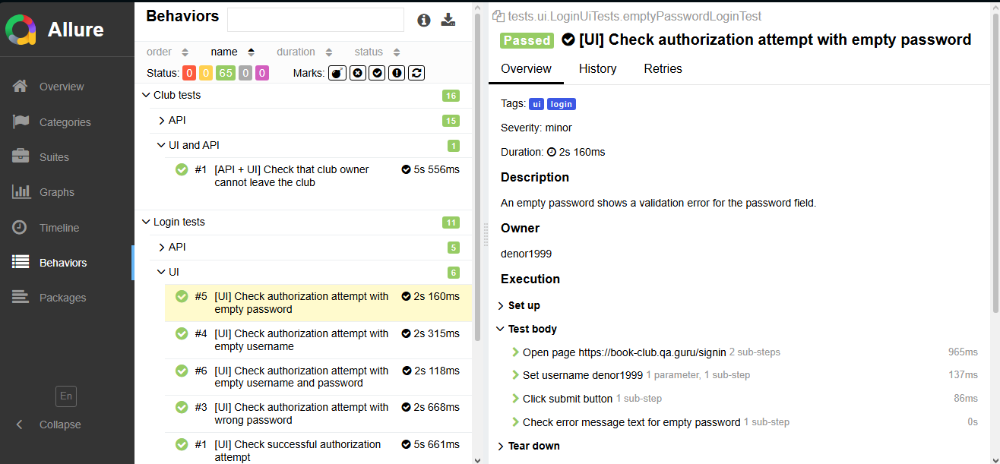
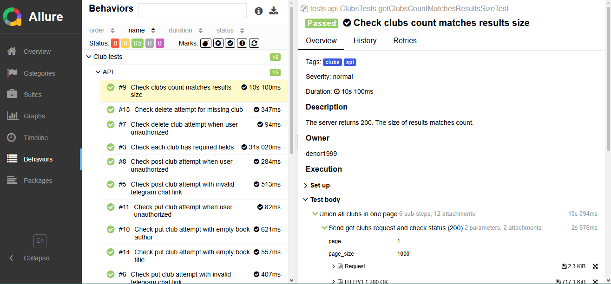
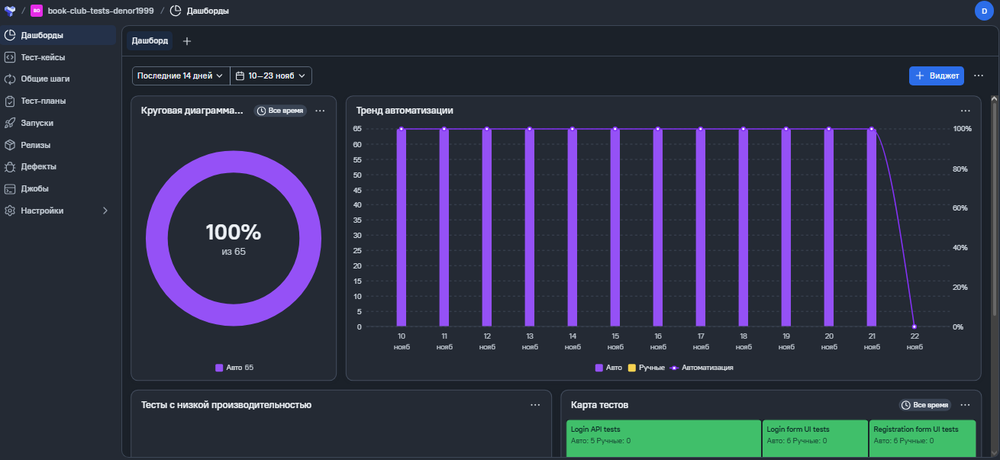
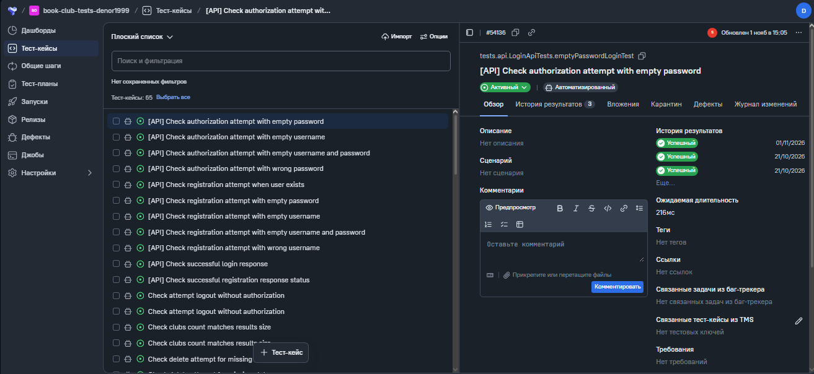
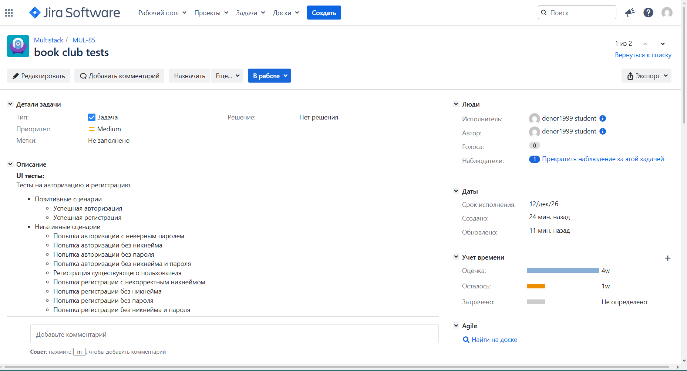
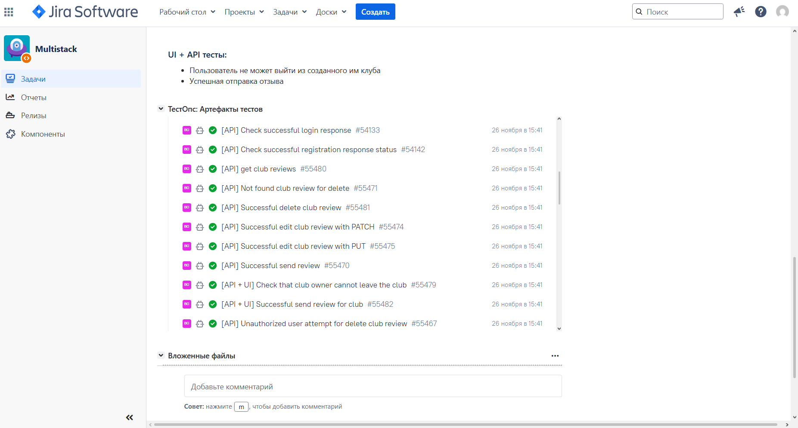

## Проект по автоматизации UI и API тестирования сервиса [Book Club QA GURU](https://book-club.qa.guru)
<a href="https://book-club.qa.guru/"></a>

---

## Структура

- <a href="#-Стек">Стек</a>
- <a href="#-Проведённые-автотесты">Проведённые автотесты</a>
- <a href="#-Сборка-в-Jenkins">Сборка в Jenkins</a>
- <a href="#-Запуск-из-терминала">Запуск из терминала</a>
- <a href="#-Allure-отчёт">Allure отчёт</a>
- <a href="#-Интеграция-с-Allure-TestOps">Интеграция с TestOps</a>
- <a href="-Интеграция-с-Jira">Интеграция с Jira</a>
- <a href="#-Видео-примеры-прохождения-UI-тестов">Видео примеры прохождения UI тестов</a>

---

## 🛠️ Стек
<p align="center">




</p>

---

## ✅ Проведённые автотесты
### Проведённые UI тесты:
Тесты на авторизацию и регистрацию
- Позитивные сценарии
  - Успешная авторизация
  - Успешная регистрация
- Негативные сценарии
  - Попытка авторизации с неверным паролем
  - Попытка авторизации без никнейма
  - Попытка авторизации без пароля
  - Попытка авторизации без никнейма и пароля
  - Регистрация существующего пользователя
  - Попытка регистрации с некорректным никнеймом
  - Попытка регистрации без никнейма
  - Попытка регистрации без пароля
  - Попытка регистрации без никнейма и пароля
  
### Проведённые API тесты:
Тесты на авторизацию, регистрацию и изменение пользователя
- Успешная авторизация
- Успешная регистрация
- Неуспешная авторизация
- Неуспешная регистрация
- Неуспешное получение токена
- Успешное изменение информации о пользователе
- Неуспешное изменение информации о пользователе
- Успешный выход из системы

Тесты работы с клубами
- Успешное получение списка всех клубов
- Проверка содержимого каждого клуба
- Успешное создание клуба
- Неуспешное создание клуба
- Успешное удаление клуба
- Удаление клуба без прав
- Удаление несуществующего клуба
- Успешное изменение клуба с PUT и PATCH
- Неуспешное изменение клуба с PUT и PATCH

Тесты проведения действий с отзывами
- Успешное получение всех отзывов о клубе
- Успешное создание отзыва
- Неуспешное создание отзыва
- Успешное изменение отзыва с PUT и PATCH
- Неуспешное изменение отзыва с PUT и PATCH
- Попытка изменения чужого отзыва
- Успешное удаление отзыва
- Неуспешное удаление отзыва
- Попытка удаления чужого отзыва

### Проведённые UI + API тесты:
- Пользователь не может выйти из созданного им клуба
- Успешная отправка отзыва

---

## 📋 Сборка в Jenkins
<p>

</p>

### Параметры сборки в Jenkins:
- Browser (используемый браузер, по умолчанию Chrome)
- Browser_Version (версия браузера, по умолчанию версия Chrome 148.0)
- Browser_Size (размер браузерного окна, по умолчанию 1920х1080)
- Headless (невидимый режим браузера, по умолчанию false)
- Remote_URL (среда запуска, по умолчанию ферма Selenoid)

---

## ▶️ Запуск из терминала
> Локальный запуск:
```shell
gradle clean test
```

> Удалённый запуск:
```shell
clean test
browser=$Browser
browser_version=$Browser_Version
browser_size=$Browser_Size
headless=$Headless
remote_url=$Remote_URL
```

---

## 📑 Allure отчёт
- Главный экран
<p>

</p>

- Страница с тестами
<p>

</p>
<p>

</p>

---

## 📑 Интеграция с Allure TestOps
- Результаты запуска тестов
<p>

</p>

- Проведённые тесты
<p>

</p>

---

## 📑 Интеграция с Jira
- Страница с задачей (описание, тест-кейсы, результаты запуска)
<p>

</p>

<p>

</p>
---

## 🎦 Видео примеры прохождения UI тестов
> К каждому UI тесту в отчете прилагается видео
<p>

</p>
<p>

</p>
<p>

</p>